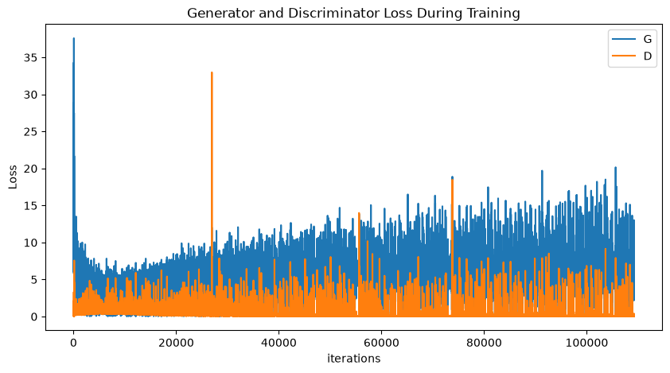
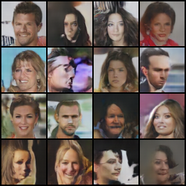

# DCGAN Face Generation

🚀 A Deep Convolutional Generative Adversarial Network (DCGAN) project that generates synthetic face images with PyTorch.

## Overview

This project explores adversarial training with a Generator and a Discriminator, trained on a large-scale face dataset. After 69 epochs, the Generator has started producing recognizable face structures. The notebook includes Generator and Discriminator loss monitoring and a generated image sample from epoch 69.

The implementation is based on the official PyTorch DCGAN tutorial.

## Progress

- **Generator:** Generates synthetic face images from random noise.
- **Discriminator:** Classifies images as real or fake.
- **Training:** Both networks are trained adversarially for 69 epochs.
- **Monitoring:** Generator and Discriminator losses are plotted to follow training progress.
- **Generated samples:** The notebook displays images produced at epoch 69.

## Results

### Generator and Discriminator Losses



### Generated Faces After 69 Epochs



## Key Learnings

This project provided hands-on experience with adversarial training, Generator–Discriminator dynamics, and the challenges of stabilizing GAN training.

Generated images still have room for improvement. Further experiments will focus on training stability and image quality.

## Technologies Used

- Python
- PyTorch
- Torchvision
- NumPy
- Matplotlib
- Kaggle GPU

## Project Structure

```text
DCGAN-Face-Generation/
├── DCGAN_Face_Generation.ipynb
├── README.md
├── requirements.txt
├── .gitignore
├── assets/
│   ├── loss-graph.png
│   └── epoch-069.png
├── models/
├── outputs/
└── checkpoints/
```

## Reference

[PyTorch DCGAN Tutorial](https://docs.pytorch.org/tutorials/beginner/dcgan_faces_tutorial.html)

## Status

🚧 In progress: continuing to experiment with training stability and image quality.
